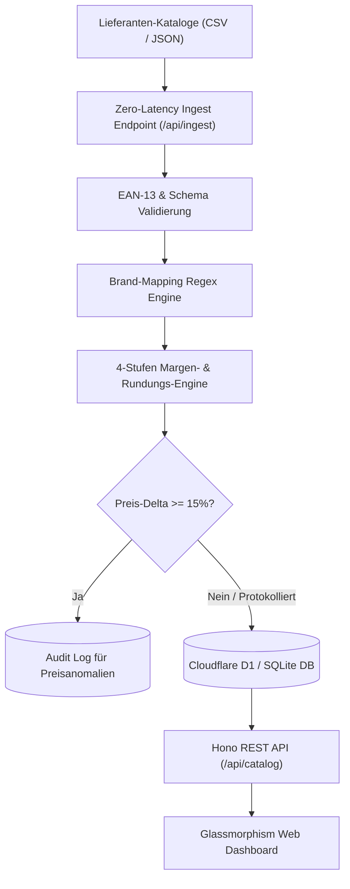

# ⚡ Edge-First E-Commerce Catalog & Price Intelligence Hub

[](https://workers.cloudflare.com/)
[](https://hono.dev/)
[](https://www.typescriptlang.org/)
[](https://developers.cloudflare.com/d1/)
[](https://vitest.dev/)
[](https://tailwindcss.com/)
[](LICENSE)

> 🌐 **Sprache / Language:** [🇩🇪 Zur deutschen Version](#-deutsche-dokumentation) | [🇬🇧 Switch to English Version](#-english-documentation)

---

## 🇩🇪 Deutsche Dokumentation

Ein extrem latenzarmer, **Edge-First Katalog- & Dynamic-Pricing-Hub** für den B2B-Großhandel und Aftermarket im Nutzfahrzeug- (NFZ) und Industriebereich. Entwickelt mit **Cloudflare Workers Edge Runtime**, **Hono**, **Cloudflare D1 / SQLite**, **Tailwind CSS** und **Alpine.js**.

---

### 🎯 Problemstellung & Business Value

#### Der Flaschenhals im klassischen E-Commerce
Im Großhandel und bei Ersatzteildistributoren liefern Zulieferer täglich umfangreiche Katalog-Feeds mit zehntausenden SKUs in unterschiedlichsten CSV- und JSON-Formaten. Monolithische ERP- und Shop-Backends (Shopware, Magento, SAP) stoßen bei nächtlichen Batch-Imports regelmäßig an ihre Grenzen: Tabellensperren, Latenzspitzen und Timeouts im Checkout führen zu direkten Umsatzverlusten.

#### Die Edge-First Lösung
Dieser Hub verlagert die gesamte Katalogverarbeitung direkt an die globale Network Edge:
1. **Latenzfreie Feed-Aufnahme:** Validiert eingehende Feeds in Sub-Millisekunden-Worker-Invocations inklusive EAN-13 GS1 Modulo-10 Prüfziffernberechnung.
2. **Automatisches Brand-Mapping:** Regex-basierte Regelübersetzung transformiert generische Lieferanten-Brands (`GENERIC_HD`, `AFTERMARKET_LINE`) in margenstarke Eigenmarken (`ApexTruck Pro`, `OmniCraft Fleet`).
3. **Dynamische 4-Stufen Pricing-Engine:** Margen werden dynamisch auf Basis von Einkaufspreis-Staffeln, Kategorie-Handlingsaufschlägen und psychologischen Rundungsregeln (`*.99 €`) kalkuliert.
4. **Audit-Trail & Preissprung-Erkennung:** Preissprünge $\ge 15\%$ werden automatisch markiert und revisionssicher protokolliert, um Margenerosion zu verhindern.
5. **Interaktives Edge-Dashboard:** Reaktives Dark-Mode Web-Interface mit 1-Klick Feed-Simulator (50 NFZ-Artikel) und Live-KPI-Metriken.

---

### 🏗️ Architektur-Ablauf



---

### 📊 Dynamisches Margenmodell

| Einkaufspreis-Staffel (€) | Basis-Marge (%) | Handling-Aufschlag (€) | Rundung | Anwendungsbereich |
| :--- | :--- | :--- | :--- | :--- |
| **0,00 € – 19,99 €** | `55.0 %` | `+ 2,50 €` | Psychologisch (`*.99 €`) | Kleinmaterial, O-Ringe, Dichtungen |
| **20,00 € – 99,99 €** | `35.0 %` | `+ 4,00 €` | Psychologisch (`*.99 €`) | Filter, Bremsbeläge, Ventile |
| **100,00 € – 499,99 €** | `22.0 %` | `+ 8,00 €` | Psychologisch (`*.99 €`) | Bremsscheiben, Sensoren, Anlasser |
| **500,00 € +** | `15.0 %` | `+ 15,00 €` | Psychologisch (`*.99 €`) | Retarder, Kompressoren, Getriebe |

---

### 🚀 Schnellstart

#### Voraussetzungen
- Node.js 20+ (LTS)

#### Installation & Start
```powershell
# 1. Klonen & Abhängigkeiten installieren
git clone https://github.com/Tom7668h/edge-commerce-sync.git
cd edge-commerce-sync
npm install

# 2. Lokalen Server starten (Dashboard auf Port 8787)
npm start

# 3. Tests ausführen
npm test
```

Dashboard im Browser: 👉 **http://localhost:8787**

---

### 🧪 Tests
```powershell
npm test
```
```text
 ✓ tests/unit/pricing.service.test.ts   (8 tests)
 ✓ tests/unit/brand-mapping.test.ts     (6 tests)
 ✓ tests/unit/validator.test.ts         (6 tests)
 ✓ tests/integration/catalog-api.test.ts(6 tests)

 Test Files  4 passed (4)
      Tests  26 passed (26)
```

---

<br><br>

---

## 🇬🇧 English Documentation

An ultra-low-latency, edge-first **Catalog Ingestion & Dynamic Price Intelligence Hub** engineered for enterprise automotive (commercial vehicle / NFZ) and industrial wholesale. Built with **Cloudflare Workers**, **Hono**, **Cloudflare D1 / SQLite**, **Tailwind CSS**, and **Alpine.js**.

---

### 🎯 The Business Challenge & Edge Solution

#### The Bottleneck in Monolithic E-Commerce
In B2B wholesale and automotive aftermarket distribution, suppliers deliver daily catalog price feeds containing tens of thousands of SKUs in heterogeneous CSV and JSON formats. Monolithic ERP and shop backends (Shopware, Magento, SAP) typically choke on nocturnal batch imports, holding table locks, causing latency spikes, and causing checkout timeouts.

#### The Edge Solution
This hub offloads catalog processing directly to the global network edge:
1. **Zero-Latency Feed Ingestion:** Streams and validates incoming feeds in sub-millisecond worker invocations with EAN-13 GS1 Modulo-10 checksum validation.
2. **Automated Brand Mapping:** Rule-based regex translation converts generic supplier names (`GENERIC_HD`, `AFTERMARKET_LINE`) into high-margin private labels (`ApexTruck Pro`, `OmniCraft Fleet`).
3. **Dynamic 4-Tier Pricing Engine:** Margins are calculated dynamically based on purchase price tiers, category handling surcharges, and psychological rounding rules (`*.99 €`).
4. **Audit Trail & Anomaly Detection:** Any price shift $\ge 15\%$ is flagged and recorded into an immutable audit trail to eliminate margin erosion.
5. **Interactive Edge Dashboard:** Zero-build Dark-Mode Web UI with a 1-click feed simulator (50 commercial vehicle parts) and live KPI telemetry.

---

### 🚀 Quickstart

```bash
git clone https://github.com/Tom7668h/edge-commerce-sync.git
cd edge-commerce-sync
npm install
npm start
```
Open **http://localhost:8787**

---

### 📄 License
MIT © Tom7668h
