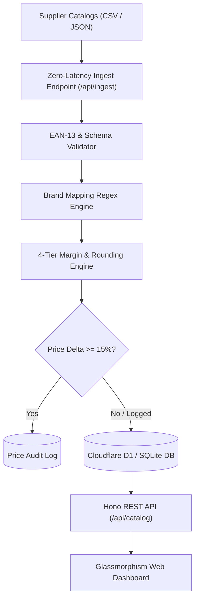

# ⚡ Edge-First E-Commerce Catalog & Price Intelligence Hub

[](https://workers.cloudflare.com/)
[](https://hono.dev/)
[](https://www.typescriptlang.org/)
[](https://developers.cloudflare.com/d1/)
[](https://vitest.dev/)
[](https://tailwindcss.com/)
[](LICENSE)

An ultra-low-latency, edge-first **Catalog Ingestion & Dynamic Price Intelligence Hub** engineered for enterprise automotive (commercial vehicle / NFZ) and industrial wholesale. Built with **Cloudflare Workers**, **Hono**, **Cloudflare D1 / SQLite**, **Tailwind CSS**, and **Alpine.js**.

---

## 🎯 The Business Challenge & Edge Solution

### The Bottleneck in Monolithic E-Commerce
In B2B wholesale and automotive aftermarket distribution, suppliers deliver daily catalog price feeds containing tens of thousands of SKUs in heterogeneous CSV and JSON formats. Monolithic ERP and shop backends (Shopware, Magento, SAP) typically choke on nocturnal batch imports, holding table locks, causing latency spikes, and causing checkout timeouts.

### The Edge Solution
This hub offloads catalog processing directly to the global network edge:
1. **Zero-Latency Feed Ingestion:** Streams and validates incoming feeds in sub-millisecond worker invocations with EAN-13 GS1 Modulo-10 checksum validation.
2. **Automated Brand Mapping:** Rule-based regex translation converts generic supplier names (`GENERIC_HD`, `AFTERMARKET_LINE`) into high-margin private labels (`ApexTruck Pro`, `OmniCraft Fleet`).
3. **Dynamic 4-Tier Pricing Engine:** Margins are calculated dynamically based on purchase price tiers, category handling surcharges, and psychological rounding rules (`*.99 €`).
4. **Audit Trail & Anomaly Detection:** Any price shift $\ge 15\%$ is flagged and recorded into an immutable audit trail to eliminate margin erosion.
5. **Interactive Edge Dashboard:** Zero-build Dark-Mode Web UI with a 1-click feed simulator (50 commercial vehicle parts) and live KPI telemetry.

---

## 🏗️ System Architecture



---

## 📊 Dynamic Pricing & Margin Model

| Purchase Price Tier (€) | Base Margin (%) | Handling Fee (€) | Rounding Mode | Target Use Case |
| :--- | :--- | :--- | :--- | :--- |
| **0,00 € – 19,99 €** | `55.0 %` | `+ 2,50 €` | Psychological (`*.99 €`) | Consumables, O-Rings, Fasteners |
| **20,00 € – 99,99 €** | `35.0 %` | `+ 4,00 €` | Psychological (`*.99 €`) | Filters, Valves, Brake Pads |
| **100,00 € – 499,99 €** | `22.0 %` | `+ 8,00 €` | Psychological (`*.99 €`) | Brake Discs, Sensors, Starters |
| **500,00 € +** | `15.0 %` | `+ 15,00 €` | Psychological (`*.99 €`) | Retarders, Compressors, Engines |

---

## 🚀 Quickstart & Local Execution

### Prerequisites
- Node.js 18+ (tested on Node.js 22 LTS)
- npm

### 1. Installation
```bash
git clone https://github.com/Tom7668h/edge-commerce-sync.git
cd edge-commerce-sync
npm install
```

### 2. Run Test Suite (Vitest)
```bash
npm test
```
Runs 26 unit and integration tests covering parser resilience, GS1 Modulo-10 checksum validation, brand mapping regex, and REST endpoints.

### 3. Build & Start the Web Service
```bash
# Type check and build
npm run build

# Start local server with web interface
npm start
```
Open **[http://localhost:8787](http://localhost:8787)** in your browser to access the dashboard.

---

## 🌐 Web Dashboard Features

- **Live KPI Telemetry:** Instant calculation of total catalog SKUs, physical stock units, total inventory value (EK / VK), and average margin percentage.
- **1-Click Feed Simulator:** Ingests 50 real-world commercial vehicle parts (MAN, Scania, Mercedes-Benz Actros, Volvo FH) with intentional price fluctuations to showcase real-time anomaly detection.
- **Brand Mapping Visualizer:** Displays original supplier brand vs. normalized internal brand with color-coded badges.
- **Audit Drawer:** Inspects all historical price variations with delta percentages, old/new prices, and audit reasons.
- **Architecture & Info Modal:** Integrated modal explaining the design decisions and edge engineering trade-offs.

---

## 🔌 REST API Specification

| Method | Endpoint | Description |
| :--- | :--- | :--- |
| `GET` | `/health` | Runtime healthcheck and environment status |
| `GET` | `/api/catalog` | Paginated catalog listing with search & category filters |
| `GET` | `/api/catalog/:sku` | Detailed article view with price history |
| `GET` | `/api/catalog/categories` | List distinct catalog categories |
| `GET` | `/api/catalog/brands` | List all resolved brands |
| `GET` | `/api/stats/summary` | Aggregated catalog KPIs and anomaly counts |
| `GET` | `/api/audit/logs` | Immutable price variation logs ($\ge 15\%$) |
| `POST` | `/api/ingest/simulate` | Simulates ingestion of 50-item NFZ feed |
| `POST` | `/api/ingest/csv` | Ingests multipart or raw CSV payload |

---

## ☁️ Cloudflare Workers Deployment

This repository is natively architected for **Cloudflare Workers** with **Cloudflare D1**:

```bash
# Deploy to Cloudflare Edge Network
npx wrangler deploy

# Execute D1 Schema Migrations in Cloudflare
npx wrangler d1 execute catalog-db --file=schema.sql
```

---

## 📄 License
MIT License. Created by [Tom7668h](https://github.com/Tom7668h).
